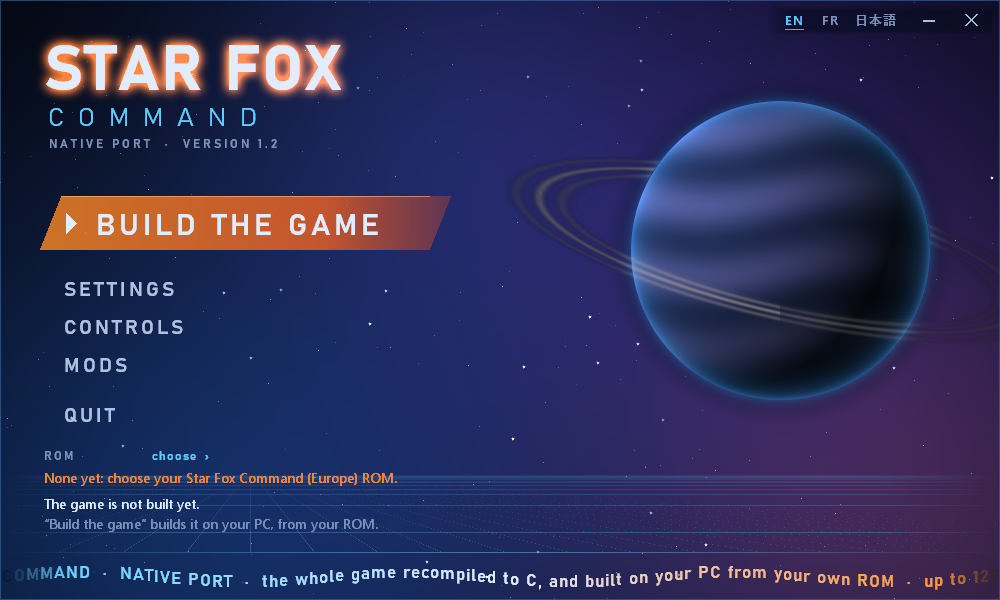

# Star Fox Command — portage natif sur PC

*English version: [README.md](README.md)*



Un portage natif pour Windows de *Star Fox Command* (Nintendo DS, 2006, Q-Games / Nintendo), fait par
**recompilation statique**. Le code du jeu lui-même est traduit instruction par instruction en C, puis réécrit
fonction par fonction en C natif, et il tourne sur PC **sans émulateur**. Le matériel de la DS qu'il attend
(mémoire, graphismes, son, minuteurs, second processeur, carte de jeu) est remplacé par une couche
d'exécution écrite pour ce projet. Sur cette base fidèle viennent quelques améliorations facultatives :
jusqu'à 120 images par seconde à l'écran, une distance d'affichage doublée, la manette, des touches
modifiables et des mods.

> **Rien du jeu n'est distribué ici : il faut votre propre cartouche.** Ce dépôt ne contient que des outils,
> une couche d'exécution et de la documentation. Le jeu est **construit sur votre PC, depuis votre
> cartouche**, par le bouton « Préparer le jeu » du lanceur. Ni le code généré ni le jeu construit ne se
> partagent : ils dérivent de votre cartouche.
>
> **Seule la cartouche européenne est prise en charge, et tout le projet a été fait et éprouvé avec elle** :
> *Star Fox Command (Europe) (En,Fr,De,Es,It)*, code de jeu `ASFP`. Les autres versions (américaine,
> japonaise…) placent leur code à d'autres adresses et sont refusées.

**Sommaire** — [Jouer](#jouer) · [Quelle cartouche](#quelle-cartouche) ·
[État du projet](#état-du-projet--ce-qui-marche-et-ce-qui-ne-marche-pas) · [Nouveautés de la 1.2](#nouveautés-de-la-12) ·
[Le lanceur](#le-lanceur) · [Commandes](#commandes) · [Comment ça marche](#comment-ça-marche) ·
[Pour les développeurs](#pour-les-développeurs) · [Licence et cadre légal](#licence-et-cadre-légal)

## Jouer

**Il faut :** Windows 10 ou 11 (64 bits), une carte graphique OpenGL 3.3, un processeur assez récent (la
simulation du jeu tourne sur un cœur), 2 Go libres pendant la construction du jeu (environ 250 Mo ensuite),
et votre copie de la cartouche européenne — un fichier `.nds`. Rien d'autre : le paquet livre les outils qui
construisent le jeu (Python, CMake et GCC, dans `outils/`).

1. Téléchargez **`starfox-command-native-1.2-windows-x64.zip`** sur la page
   [Releases](https://github.com/SerenityG4K/starfox-command-native/releases) et décompressez-le où vous voulez.
2. Double-cliquez sur **`lanceur.exe`**. Il parle anglais, français ou japonais : choisissez en haut à droite
   (**EN · FR · 日本語**).
3. Désignez votre cartouche (**CARTOUCHE › choisir**, ou *Réglages › Parcourir…*). Une copie réduite à ses
   données utiles (« trimmed ») convient aussi.
4. Cliquez sur **PRÉPARER LE JEU**. Le lanceur traduit le code du jeu, le réécrit en C natif et le compile,
   sur votre machine, depuis votre cartouche (`tools/preparer.py`). Comptez environ **11 minutes** sur un
   processeur à 16 fils (11 min 23 s mesurées depuis le seul paquet), davantage sur une machine plus
   modeste. La machine reste utilisable ; fermer le lanceur arrête la construction.
5. Le bouton devient **JOUER**. C'est tout.

La partie s'enregistre dans `sauvegarde\starfox_command.sav`, à côté du lanceur. Ce que le jeu dit — et
pourquoi il s'arrête, s'il s'arrête — va dans `journal.txt`, à côté aussi. Une nouvelle version du portage
demande de préparer le jeu à nouveau (le lanceur le dit).

**Les langues.** La langue du lanceur (EN, FR, 日本語) n'est pas celle du jeu. Le jeu n'a pas de menu de
langue — sur la console, il lit celle du système —, alors le lanceur propose les langues **que porte votre
cartouche** : l'européenne a l'anglais, le français, l'allemand, l'espagnol et l'italien. Une cartouche
japonaise apporterait le japonais, mais ce portage ne la fait pas tourner (voir plus bas).

## Quelle cartouche

| Version | Code de jeu | État |
|---|---|---|
| Europe — *Star Fox Command (Europe) (En,Fr,De,Es,It)* | `ASFP` | ✅ la seule prise en charge ; tout ici a été fait et éprouvé avec elle |
| États-Unis, Japon, autres | `ASFE`, `ASFJ`… | ❌ refusées : leur code vit à d'autres adresses, le code recompilé ne leur correspondrait pas |

La préparation vérifie la cartouche avant tout : son code de jeu, puis l'empreinte SHA-1 de ses données
utiles (`16abd9f61c0a34d76a1800511457b32ac663cd57`, les `0x0393467C` premiers octets). Une copie complète de
64 Mo et une copie réduite donnent la même. Une cartouche modifiée, traduite ou patchée est refusée ; l'outil
en ligne de commande l'accepte avec `--forcer`, à vos risques.

## État du projet : ce qui marche, et ce qui ne marche pas

**Ce qui marche**

- **Tout le jeu en solo**, du démarrage au générique : histoire, carte de stratégie, missions en vol, dans
  les cinq langues, avec la musique, le son et la sauvegarde. L'histoire a été jouée jusqu'à sa fin sur le
  portage ; toutes ses branches n'ont pas encore été parcourues.
- **Les deux processeurs tournent en C natif** par défaut : l'ARM9 (le jeu) et l'ARM7 (le son, l'écran
  tactile, la carte). Ni interpréteur, ni cœur d'émulation.
- **Jusqu'à 120 images par seconde à l'écran** (60, 90 ou 120), chacune placée entre deux images du jeu,
  avec l'anticipation pour garder des commandes réactives (voir la limite plus bas).
- **La distance d'affichage doublée** (décor, ennemis, tirs), par défaut, et réversible.
- **Le clavier** (touches modifiables), **la manette** (Xbox, PlayStation, Switch Pro, générique), **la
  souris** pour l'écran tactile.
- **Les mods**, tous éteints par défaut : le vaisseau de chaque pilote (laser, verrouillage, jauge du turbo,
  apparence), les dégâts infligés et reçus, l'invincibilité, le turbo et les bombes infinis, le tir chargé au
  maximum.
- **La construction chez le joueur** : depuis le seul paquet publié, sur un PC sans aucun outil installé,
  elle a donné un code identique à celui du développement, et un jeu dont la mémoire, sur une partie
  enregistrée rejouée image par image, est identique à celle du jeu du développement sur 8 000 images.

**Les limites**

- **La logique du jeu garde le rythme de la console** : 60 tours par seconde dans les menus, 30 en vol. Les
  cadences plus hautes viennent de l'interpolation entre deux images du jeu, pas d'un jeu qui penserait plus
  vite (il s'accélérerait). Au-delà de 120 images par seconde, cette interpolation est moins stable : le
  lanceur s'arrête à 120. **Une logique du jeu nativement à 60 et 120 images par seconde est le prochain
  objectif**, dans un chantier à part.
- Les couches 2D (menus, carte, écran tactile) restent aux 256×192 de la console : ce sont des tuiles rangées
  en mémoire vidéo. La 3D suit la taille de la fenêtre.
- À distance double, la console simulée passe un peu plus de temps par image, comme la vraie le ferait : ce
  que le jeu tire de son horloge fine (certains tirages au hasard, le moment d'un événement) peut différer
  d'une partie jouée à la distance d'origine. *Distance › Comme la console* garde une fidélité stricte.
- Windows seulement pour l'instant (la couche de fenêtre est en Win32 + WGL). La simulation tient sur un seul
  fil et dépend du processeur.

**Ce qui ne marche pas**

- **Le téléchargement DS et le Wi-Fi** : la radio de la DS n'est pas émulée, et les serveurs Wi-Fi de
  Nintendo ont fermé en 2014. Ces modes bloquent, et le chien de garde arrête le jeu au bout de huit
  secondes. Pas de multijoueur.
- **Les autres versions de la cartouche** (voir plus haut).

**Jusqu'où la décompilation est prouvée.** Le jeu recompilé tourne, par défaut, en C natif réécrit par
`tools/decomp_feuilles.py`, qui interprète chaque fonction symboliquement. ARM9 : **29 627 fonctions sur
29 694** réécrites (le reste : des données prises pour du code, et la commutation de contexte que la couche
d'exécution remplace). Deux bancs comparent chaque réécriture à la traduction directe, en jeu et sur des
états tirés au hasard : **26 689 sont prouvées chemin par chemin, aucune fautive**, et 3 072 attendent encore
un chemin qu'aucune épreuve n'a su prendre — elles tournent quand même, et rien ne les a prises en défaut.
ARM7 : 1 035 sur 1 039 réécrites, 871 prouvées. Les deux processeurs en natif, 520 000 images de longues
parties rejouées gardent des **empreintes mémoire identiques et 1,1 Go de son identique au bit près** par
rapport à la traduction. La méthode est dans [docs/reference.md](docs/reference.md).

## Nouveautés de la 1.2

| | |
|---|---|
| **Construit chez vous** | plus rien du jeu n'est distribué, pas même recompilé : le lanceur le construit depuis votre cartouche, avec Python, CMake et GCC livrés — rien à installer |
| **Distance d'affichage ×2** | le décor, les ennemis et les tirs portent deux fois plus loin ; l'anneau d'horizon recule d'autant. Les lasers vivent deux fois plus longtemps, les ennemis qui tirent selon la distance ouvrent le feu de deux fois plus loin. Greffé sur le jeu réécrit par des **points de modification** (`runtime/modifications.c`), sans réécrire ses fonctions |
| **Page Mods** | le vaisseau de chaque pilote (laser, verrouillage, jauge du turbo, apparence), les dégâts, l'invincibilité, le turbo et les bombes infinis, le tir chargé au maximum — tout est éteint par défaut |
| **Manette** | les commandes de *Star Fox 64 3D* ; chaque bouton agit directement dans le cockpit du jeu — turbo, frein, tonneaux, loopings, demi-tours, bombes |
| **Page Contrôles** | chaque touche du clavier se change |
| **Nouveau lanceur** | une fenêtre sans cadre à la manière des lanceurs d'autrefois, illustrée par les images de **votre** cartouche ; en anglais, en français et en japonais |
| **Le logo du jeu** | la fenêtre du jeu, la barre des tâches et `sfc.exe` lui-même portent l'emblème de votre cartouche |
| **Cadence** | 60, 90 ou 120 images par seconde (120 par défaut) |
| **Plus rapide** | l'interpolation sur le GPU, les deux écrans composés sur plusieurs cœurs, une boucle de simulation allégée |

| Version | Date | Ce qu'elle a apporté |
|---|---|---|
| `v1.0-jouable` | 13/09/2026 | le jeu se termine : du démarrage au générique, dans les cinq langues, avec le son et la sauvegarde |
| `v1.1` | 22/09/2026 | le jeu entier en C natif ; l'affichage détaché du jeu, jusqu'à 240 images par seconde ; le lanceur |
| `v1.2` | 09/11/2026 | la première version publique — tout ce qui précède |

## Le lanceur

| Réglage | Ce qu'il fait |
|---|---|
| **Cartouche** | votre copie de Star Fox Command (Europe). Un dossier de données (son `index.bin`) est accepté aussi : c'est ainsi qu'on joue avec des fichiers modifiés (voir *Un dossier de données, pour modifier les fichiers*) |
| **Langue du jeu** | parmi celles de votre cartouche — le jeu n'a pas de menu pour elle |
| **Finesse**, **Textures** | la 3D calculée plus finement puis réduite, les textures adoucies ; *Comme la console* et *Nettes* gardent l'image d'origine |
| **Images par s.** | 60, 90 ou 120 (par défaut), chaque image placée entre deux images du jeu |
| **Distance** | *Double* par défaut : décor et ennemis vus deux fois plus loin, tirs qui portent deux fois plus loin ; *Comme la console* garde l'original |
| **Son** | le processeur du son de la console, recompilé : sans lui le jeu tourne, muet |
| **Réaction** (pour les spécialistes) | *Fluide* (par défaut) : l'affichage reste un tour derrière le jeu et glisse entre ses deux dernières images — l'interface glisse aussi. *Immédiate* : la plus récente dès qu'elle arrive, son mouvement prolongé. *Selon la scène* : fluide dans les menus, immédiate en vol |
| Page **Contrôles** | une touche par commande : un clic sur la commande, puis la nouvelle touche ; une touche déjà prise est échangée. *Touches d'origine* les remet. Le sens du stick de la manette (celui de *Star Fox 64* au choix) |
| Page **Mods** | voir plus haut ; *Aucun mod* ramène le jeu de votre cartouche |

**L'anticipation** est toujours active, ce n'est pas un réglage : pendant que le jeu attend son tour suivant,
le portage le calcule d'avance avec vos commandes du moment, prend l'image, puis remet tout exactement comme
avant — le jeu se joue comme sur la console, et l'affichage glisse vers une image déjà connue.

Les réglages vivent dans `lanceur.ini`, à côté du lanceur. Entrée joue, Échap referme la page ouverte.

## Commandes

| Commande | Touche par défaut |
|---|---|
| A, B, X, Y | Z, E, A, S |
| L, R | Q, W |
| Start, Select | Espace, Tab |
| Croix | les flèches |
| Avance rapide (tenue, ×8) | F |
| Noter un défaut d'image (les 120 dernières images, écrites dans `journal.txt`) | P |
| Écran tactile | la souris |

**À la manette** — Xbox, PlayStation, Switch Pro ou générique, branchée avant ou pendant la partie —, les
commandes de vol sont celles de *Star Fox 64 3D* : stick gauche pour diriger (poussé, l'Arwing monte, comme
au stylet ; la page Contrôles offre le sens de *Star Fox 64*, où il pique), A (✕) laser, X (□) turbo, B (○)
frein, RB/RT (R1/R2) tonneau à droite, LB/LT à gauche, Y (△) bombe ; le stick vers la montée avec le turbo
fait un looping, avec le frein un demi-tour. Chaque bouton donne sa commande directement au cockpit du jeu,
là où le stylet donne la sienne. Ailleurs, les boutons de la console, et la souris pour ce qui ne se fait
qu'au toucher. Le détail : [docs/reference.md](docs/reference.md), « Les commandes du vol, et la manette ».

## Comment ça marche

1. **La cartographie.** Les binaires du jeu — l'ARM9, ses 26 overlays et le coprocesseur ARM7 — sont
   cartographiés fonction par fonction : où chacune commence, ses blocs, ses appels, ses tables de sauts.
   Le résultat, la **carte du code**, ne contient que des adresses ; elle est livrée dans `tools/carte/`.
2. **La traduction.** Guidée par la carte, chaque instruction de votre cartouche est traduite en C
   (`tools/recomp/`). Cette traduction directe est la référence : c'est le jeu, au bit près dans sa logique.
3. **La réécriture native.** Chaque fonction est ensuite réécrite en C natif (`tools/decomp_feuilles.py`) et
   prouvée contre la traduction, chemin par chemin, par deux bancs. Le jeu réécrit tourne par défaut.
4. **La couche d'exécution.** Écrite pour le portage (`runtime/`, MIT), elle tient lieu de DS : la mémoire et
   ses registres, les interruptions, le DMA, les minuteurs, la carte de jeu, la liaison entre les deux
   processeurs, le moteur 3D (vers OpenGL), les moteurs 2D, le mixage du son, les entrées, la fenêtre — le
   harnais dans lequel tourne le jeu recompilé.
5. **Par-dessus** : l'affichage détaché et son interpolation, l'anticipation, et les **points de
   modification** — des crochets posés avant une instruction du jeu réécrit, qui changent une valeur sans
   réécrire la fonction. La distance d'affichage, les mods et les commandes de la manette sont faits ainsi, et
   restent éteints quand leur réglage l'est.

Comme d'autres projets de recompilation récents, le portage livre des outils et une couche d'exécution,
jamais le jeu : la traduction, la réécriture et la compilation se font sur la machine du joueur, depuis sa
cartouche.

## Pour les développeurs

Les documents du développement sont écrits en français, avec une copie anglaise des principaux dans
[docs/en/](docs/en/README.md) ; les commentaires du code sont en français. Il faut Python 3.10 ou plus
récent, CMake et GCC pour Windows (MinGW-w64) — ou ceux que `tools/outils.py` pose dans `outils/`.

### Construire depuis les sources

Placez votre copie de la ROM à la racine du projet.

**En une commande** — c'est ce que fait « Préparer le jeu » dans le lanceur : de la
cartouche à `jeu/sfc.exe`, sans rien d'autre que le dépôt.

```bash
python tools/preparer.py "Star Fox Command (Europe) (En,Fr,De,Es,It).nds" --langue fr
```

Ses messages sont en anglais par défaut (`--langue fr` ou `--langue ja` pour le français ou le japonais ; le
lanceur passe la sienne). `--garder` garde le dossier de travail (code généré, journaux).

Elle reconnaît la cartouche (son empreinte), la découpe en fichiers, traduit le code des
deux processeurs d'après la **carte du code** livrée dans `tools/carte/` — des adresses
seulement : le début de chaque fonction, ses blocs, ses appels, ses tables de sauts —,
nomme ce que le binaire nomme, réécrit chaque fonction en C natif, et compile, en donnant à
sfc.exe l'emblème de la cartouche pour icône (`tools/icone.py`). Le code
qu'elle produit est identique, octet pour octet, à celui du développement (seul change le
champ des preuves, qui reste chez le développeur et ne change rien au jeu). La carte se
refait avec `tools/codemap.py`, ci-dessous ; elle est livrée telle qu'elle a servi, pour
que chacun retrouve exactement le même code.

`tools/paquet.py` assemble une version publiable : ce que le dépôt versionne, le lanceur
compilé et, avec `--avec-outils`, les outils de construction de `outils/`. Il contrôle
chaque fichier avant d'écrire l'archive — aucune image de cartouche, aucun dossier
généré, aucun exécutable du jeu — et refuse tout le paquet à la moindre infraction.

Les outils de construction joints au paquet — Python 3.13.15 (la version embarquable de
python.org), CMake 4.4.5 et GCC 16.2.0 (WinLibs, révision r2 : le compilateur du développement) —
se refont avec `python tools/outils.py` : il les télécharge depuis leurs sources officielles,
vérifie chaque archive par son empreinte SHA-256 et les pose dans `outils/`, qui n'est pas
versionné. Leurs versions, sources et licences sont dans [docs/outils.md](docs/outils.md), joint
au paquet ; GCC étant sous GPL, une version publiée doit garder à côté l'indication de ses sources.
Un paquet complet pèse 347 Mo ; un joueur sans aucun outil installé y prépare le jeu tel quel.

Pas à pas :

Cartographier le binaire :

```bash
python tools/arm9map.py "Star Fox Command (Europe) (En,Fr,De,Es,It).nds"
```

```bash
python tools/codemap.py "Star Fox Command (Europe) (En,Fr,De,Es,It).nds"
```

Générer le C (dans `generated/`, non versionné) et construire :

```bash
python tools/recomp/recomp.py "Star Fox Command (Europe) (En,Fr,De,Es,It).nds"
```

```bash
cmake -S runtime -B build/runtime -G "MinGW Makefiles" && cmake --build build/runtime -j 8
```

Lancer (le second argument est le délai du chien de garde, en secondes) :

```bash
./build/runtime/sfc.exe "Star Fox Command (Europe) (En,Fr,De,Es,It).nds" 10
```

**Avec le son** — c'est la construction que trouve le lanceur —, il faut aussi
cartographier et traduire le binaire du coprocesseur, puis construire une variante
qui le porte :

```bash
python tools/codemap.py "Star Fox Command (Europe) (En,Fr,De,Es,It).nds" --arm7 --out analysis/codemap_arm7.json
```

```bash
python tools/recomp/recomp.py "Star Fox Command (Europe) (En,Fr,De,Es,It).nds" --codemap analysis/codemap_arm7.json --out generated7 --suffixe 7
```

```bash
cmake -S runtime -B build/runtime8 -G "MinGW Makefiles" -DSFC_ARM7=ON && cmake --build build/runtime8 -j 8
```

```bash
SFC_ARM7=1 ./build/runtime8/sfc.exe "Star Fox Command (Europe) (En,Fr,De,Es,It).nds"
```

### Un dossier de données, pour modifier les fichiers

Pour jouer, la cartouche suffit. Pour modifier les fichiers du jeu, le portage sait
aussi lire ses données dans un dossier, découpé dans **votre** cartouche — il ne se
distribue pas plus qu'elle. `tools/build_data.py` la découpe une fois pour toutes :

```bash
python tools/build_data.py "Star Fox Command (Europe) (En,Fr,De,Es,It).nds" -o data
```

On obtient `data/files/` (l'arborescence du jeu, 3 556 fichiers), `data/system/`
(en-tête, binaires des deux processeurs, tables, bannière) et `data/index.bin`,
qui dit où chaque morceau se trouve dans l'espace d'adressage de la cartouche.
Les octets sont copiés tels quels, sans décompression : c'est le jeu qui
décompresse, et lui donner autre chose le tromperait.

Le jeu se lance alors sans argument — il cherche `data/` à côté de lui, ou là où
`SFC_DATA` le désigne :

```bash
SFC_ARM7=1 ./build/runtime8/sfc.exe
```

Ce dossier reconstitue la cartouche **à l'octet près** (vérifié sur les 64 Mo),
et une partie rejouée depuis l'un ou l'autre donne les mêmes empreintes mémoire
image par image. Rien ne change pour le jeu ; ce qui change, c'est que chaque
fichier devient un fichier, remplaçable.

Pour lire les fichiers du jeu et en remplacer un — un texte, un script, une
couleur, dans le dossier ou dans une archive `.srl`, même s'il change de
taille —, voir [la procédure](docs/assets.md) et `tools/fichier_du_jeu.py`.

### Vitesse

Le portage est lié au processeur : il simule deux ARM instruction par instruction,
décode les textures et compose les deux écrans en logiciel, le tout sur un seul
fil — ni les cœurs supplémentaires ni la carte graphique n'y changent rien.

`SFC_PROFILE=1` relève où passe le temps d'une image, phase par phase, ainsi que
le nombre de textures demandées, distinctes et redécodées. `SFC_PROFILE_ARM9` et
`SFC_PROFILE_ARM7` échantillonnent chacun des deux processeurs pour savoir
quelles fonctions du jeu coûtent, faute de symboles.

Ces relevés ont fait passer l'image de **17,5 à 8,4 ms** — le budget étant de
16,7 — par cinq corrections, toutes dans notre code :

| | avant | après |
|---|---|---|
| image complète | 17,5 ms | **8,4 ms** |
| rendu | 8,54 | **1,92** |
| — composition des deux écrans | 4,48 | 1,58 |
| — textures | 3,69 | 0,21 |
| simulation | ~9 | 6,4 |

1. Le runtime n'avait aucune option d'optimisation, le type de construction par
   défaut étant Debug ; il passe en `-O3`. Le code généré reste en `-O1` :
   `-O2` n'y change rien, ses fonctions sont trop grandes pour que le
   compilateur fasse mieux (`SFC_OPT` permet d'en juger).
2. Le format de texture 4x4 compressé, celui des décors, était redécodé à chaque
   image faute d'empreinte.
3. Les deux moteurs 2D sont indépendants : ils se composent en parallèle.
4. Les minuteurs du coprocesseur refaisaient deux divisions 64 bits par appel
   d'horloge ; leur prochaine échéance est retenue.
5. On basculait vers le coprocesseur à chaque appel d'horloge ; on attend
   désormais huit arêtes.

**Une optimisation ne se juge pas sur la cadence.** Pousser le budget d'arêtes
ou le seuil du coprocesseur donne jusqu'à cinq fois plus d'images par seconde —
en mettant le coprocesseur hors jeu, le son devenant alors muet. Toute
modification de l'ordonnancement se vérifie sur l'enregistrement (`SFC_WAV`) :
les valeurs retenues gardent le son identique au bit près, ou à 96,6 % pour le
seuil du coprocesseur.

Le son, lui, ne dépend pas de la cadence du jeu, comme sur la console où le
coprocesseur et le matériel audio sont indépendants : si la simulation prend du
retard, les canaux avancent quand même. `SFC_SND_SIMULE=1` revient à l'ancien
comportement pour comparer.

### Rendu

Par défaut l'image est celle de la console, au pixel près. Deux réglages
l'améliorent, indépendants l'un de l'autre :

```bash
SFC_SCALE=3 SFC_FILTER=2 SFC_ARM7=1 ./build/runtime8/sfc.exe "Star Fox Command (Europe) (En,Fr,De,Es,It).nds"
```

`SFC_SCALE` (1 à 4) rend la scène dans un tampon N fois plus grand que la fenêtre
avant de le réduire : chaque pixel affiché devient la moyenne de N×N points
calculés, ce qui lisse les bords des polygones. `SFC_FILTER` adoucit les textures
(1 bilinéaire, 2 avec mipmaps) ; les texels transparents reçoivent au passage la
couleur de leurs voisins opaques, sans quoi le filtrage cernerait les objets d'un
liseré sombre.

Mesuré en combat aérien, fenêtre de 512×768 : 205 images par seconde sans rien,
166 en ×2, 148 en ×3, 129 en ×4 — le jeu en demande 60.

`SFC_AFFICHAGE=libre` détache l'affichage du jeu : le jeu garde son rythme — soixante
balayages par seconde, trente tours en vol, il ne sait pas penser plus vite sans
s'accélérer — et l'écran reçoit autant d'images que `SFC_IPS` le permet (un nombre, 240
par défaut ; `vsync` pour la cadence de l'écran ; `0` sans limite), chacune placée entre
deux images du jeu. Une machine lente affiche moins d'images sans ralentir le jeu. Le
lanceur (`lanceur.exe` à la racine, « Images par s. ») règle tout cela sans ligne de
commande — 60, 90 ou 120 images par seconde, au-delà l'interpolation est moins stable — et se
souvient de ses réglages ; le détail est dans `docs/plan_framerate.md`.

La fenêtre garde les proportions des deux écrans quand on la redimensionne, et la
3D est rendue à la résolution de la fenêtre : l'agrandir suffit à gagner en
finesse. Les couches 2D (fonds, menus, carte tactile), elles, restent en 256×192 :
ce sont des tuiles rangées en mémoire vidéo, leur finesse est celle des données.

La partie s'enregistre dans `sauvegarde/starfox_command.sav`, à côté du dépôt et
non dans `build/` que l'on efface pour recompiler. `SFC_SAVE=chemin` la déplace :
c'est ce qu'il faut pour essayer quelque chose sans toucher à une partie en
cours, et ce qu'il ne faut surtout pas mettre pour jouer — chaque essai repartirait
d'une sauvegarde vierge.

Variables d'environnement utiles : `SFC_NO_VIDEO=1` (sans fenêtre),
`SFC_MAX_FRAMES=n` (arrêt propre après n images), `SFC_TRACE_THREADS=1`
(journal des commutations de threads, avec la pile d'appels du thread qui
s'endort), `SFC_TRACE_CARD=1` (commandes de la carte, DMA, interruptions),
`SFC_DUMP=n` (capture PNG toutes les n images dans `build/` ; 1,5 Mo par
capture, à espacer), `SFC_HASH=fichier` (empreinte de l'état par image),
`SFC_INPUT_RECORD=fichier` et `SFC_INPUT_REPLAY=fichier` (entrées
enregistrées et rejouées, pour comparer deux versions sur la même partie ;
elles s'appliquent aussi sans fenêtre), `SFC_ARM7=1` (le coprocesseur traduit
aux commandes), `SFC_WAV=fichier` et `SFC_WAV_FROM=n` (enregistrer le son, à
partir de l'image n), `SFC_NO_AUDIO=1` (pas de sortie audio).

Quand l'exécutable saute vers du code que la cartographie ne connaît pas, il
s'arrête en consignant l'adresse dans `analysis/amorces.txt` ; la
cartographie suivante la relit comme amorce manuelle.

Vérifier le traducteur contre unicorn (`pip install capstone unicorn`) :

```bash
python tools/recomp/test_diff.py "Star Fox Command (Europe) (En,Fr,De,Es,It).nds" --count 5000
```

Vérifier aussi les transferts de contrôle (sans ROM, avec GCC) :

```bash
python tools/recomp/test_return_dispatch.py
python tools/recomp/test_irq_return.py
```

Ces tests couvrent notamment les rappels des anneaux bleus : certains ajustent
leur pointeur d'objet puis dépilent l'adresse de la méthode avec `POP {PC}`.
Cette instruction doit exécuter la méthode ; la traiter systématiquement comme
un retour supprimait le bonus malgré un passage correctement détecté.

Désassembler une fonction (adresse RAM) :

```bash
python tools/disasm.py "Star Fox Command (Europe) (En,Fr,De,Es,It).nds" 0x02019838
```

### Reconstruire le lanceur

Le lanceur est en Win32 pur, sans dépendance (`launcher/`) : `launcher.c` (la fenêtre, les pages, la
préparation), `habillage.c` (tout ce qui est dessiné), `images.c` (les images, l'icône et les archives de
langue lues dans la cartouche), `textes.c` (ses textes en anglais, en français et en japonais).

```bash
gcc -O2 -municode -mwindows launcher/launcher.c launcher/habillage.c launcher/images.c launcher/textes.c -o lanceur.exe -lcomctl32 -lcomdlg32 -lgdi32
```

Pendant le développement, il lance le jeu construit dans `build/runtime8/` ; chez le joueur, celui préparé
dans `jeu/`.

### Organisation du dépôt

```
tools/            outils Python 3.11+
  nitro/          ROM, compression, image mémoire, cartographie du code, formats
  recomp/         décodeurs ARM/Thumb, émetteur C, pilote, bancs d'essai
  carte/          la carte du code livrée (adresses seulement), que lit tools/preparer.py
runtime/          couche d'exécution en C (MIT) : processeur, mémoire, matériel
launcher/         source du lanceur (lanceur.exe, à la racine, non versionné)
docs/images/      le lanceur, tel qu'il est sans cartouche (dessiné par lui-même : rien du jeu)
generated/        C généré depuis la ROM — traduction et réécritures du générateur (jamais versionné)
analysis/         résultats de la cartographie (jamais versionnés)
build/runtime8/   le jeu construit pendant le développement, avec le son — celui que lance le lanceur
jeu/              le jeu préparé chez le joueur depuis sa cartouche (jamais versionné ni distribué)
outils/           les outils de construction livrés : Python, CMake, GCC (tools/outils.py, jamais versionnés)
build/enregistrements/  parties enregistrées (SFC_INPUT_RECORD) et leurs sauvegardes de départ
docs/             plan, carte du binaire, formats, langage de script
docs/en/          les documents principaux, en anglais
```

## Auteur

Créé et mené par **[SerenityG4K](https://github.com/SerenityG4K)**.

## Licence et cadre légal

Le code de ce dépôt est publié sous [licence MIT](LICENSE). Il ne contient ni ne redistribue aucun élément
protégé appartenant à Nintendo ou Q-Games : les outils lisent la copie personnelle de l'utilisateur, le code
généré en dérive et reste sur sa machine, et l'exécutable a besoin de cette copie pour fonctionner. Le jeu
n'est distribué sous aucune forme, pas même recompilée : chacun le construit chez lui depuis sa cartouche
(`tools/preparer.py`, « Préparer le jeu » dans le lanceur), et ni le code généré ni le jeu construit ne se
partagent. La carte du code livrée (`tools/carte/`) ne contient que des adresses. Les images et l'icône du
lanceur sont lues dans la cartouche du joueur à chaque lancement ; les captures de `docs/images/` ne montrent
que ce que le lanceur dessine lui-même.

Le paquet publié joint aussi Python, CMake et GCC, non modifiés, sous leurs propres licences ; GCC est sous
GNU GPL : [docs/outils.md](docs/outils.md) donne leurs versions, leurs sources officielles et leurs
empreintes, et où trouver les sources de GCC.

*Star Fox* et *Star Fox Command* sont des marques de Nintendo. Ce projet n'est ni affilié à Nintendo ou
Q-Games, ni approuvé par eux.
