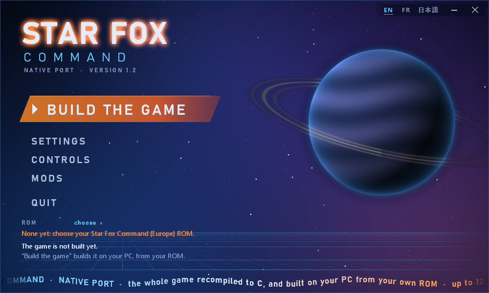
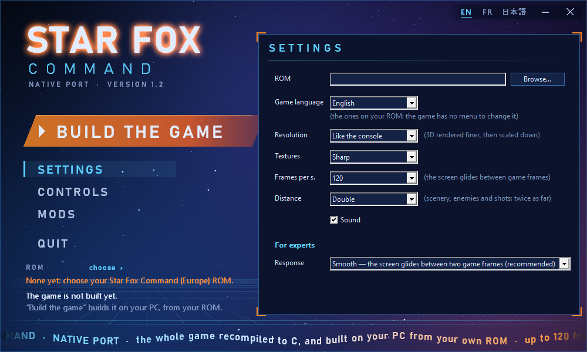

# Star Fox Command — native PC port

*Version française : [README.fr.md](README.fr.md)*



A native Windows port of *Star Fox Command* (Nintendo DS, 2006, Q-Games / Nintendo), made by **static
recompilation**. The game's own code is translated instruction by instruction into C, then rewritten function
by function into native C, and it runs on PC **without an emulator**. The DS hardware it expects (memory,
graphics, sound, timers, the second processor, the game card) is replaced by a runtime layer written for this
project. On top of that faithful base come a few optional improvements: up to 120 frames per second on screen,
twice the draw distance, gamepad support, key remapping and mods.

> **Nothing from the game is distributed here: you need your own ROM.** This repository holds tools, a runtime
> and documentation only. The game is **built on your PC, from your ROM**, by the launcher's “Build the game”
> button. Neither the generated code nor the built game may be shared: they derive from your ROM.
>
> **Only the European ROM is supported, and the whole project was made and tested with it**: *Star Fox Command
> (Europe) (En,Fr,De,Es,It)*, game code `ASFP`. Other versions (American, Japanese…) place their code at
> other addresses and are refused.

**Contents** — [Play](#play) · [Which ROM](#which-rom) · [Project status](#project-status-what-works-and-what-does-not) ·
[What's new in 1.2](#whats-new-in-12) · [The launcher](#the-launcher) · [Controls](#controls) ·
[How it works](#how-it-works) · [For developers](#for-developers) · [License and legal](#license-and-legal-framework)

## Play

**You need:** Windows 10 or 11 (64-bit), a graphics card with OpenGL 3.3, a reasonably recent processor (the
game's simulation runs on one core), 2 GB of free disk space while the game is being built (about 250 MB
afterwards), and your copy of the European ROM — a `.nds` file. Nothing else: the package ships the tools
that build the game (Python, CMake and GCC, in `outils/`).

1. Download **`starfox-command-native-1.2-windows-x64.zip`** from the
   [Releases](https://github.com/SerenityG4K/starfox-command-native/releases) page and unzip it anywhere.
2. Double-click **`lanceur.exe`** (the launcher). It speaks English, French or Japanese: switch at the top
   right (**EN · FR · 日本語**).
3. Choose your ROM (**ROM › choose**, or *Settings › Browse…*). A copy trimmed to its useful data works too.
4. Click **BUILD THE GAME**. The launcher translates the game's code, rewrites it in native C and compiles it,
   on your machine, from your ROM (`tools/preparer.py`). It takes about **11 minutes** on a 16-thread
   processor (11 min 23 s measured from the package alone), longer on a more modest one. The window stays
   usable; closing the launcher stops the build.
5. The button becomes **PLAY**. That's it.

Your progress is saved in `sauvegarde\starfox_command.sav`, next to the launcher. What the game reports —
and why it stopped, if it ever does — goes to `journal.txt`, next to it too. A new version of the port asks
you to build the game again (the launcher says so).

**Languages.** The launcher's own language (EN, FR, 日本語) is separate from the game's. The game has no
language menu — on the console it reads the system's language —, so the launcher offers the languages
**found on your ROM**: the European ROM carries English, French, German, Spanish and Italian. A Japanese
ROM would bring Japanese, but this port does not run it (see below).

## Which ROM

| Version | Game code | Status |
|---|---|---|
| Europe — *Star Fox Command (Europe) (En,Fr,De,Es,It)* | `ASFP` | ✅ the only one supported; everything here was made and tested with it |
| United States, Japan, others | `ASFE`, `ASFJ`… | ❌ refused: their code lives at other addresses, the recompiled code would not match |

The build checks the ROM before doing anything: its game code, then the SHA-1 fingerprint of its useful data
(`16abd9f61c0a34d76a1800511457b32ac663cd57`, the first `0x0393467C` bytes). A full 64 MB dump and a trimmed
copy give the same fingerprint. A modified, translated or patched ROM is refused; the command-line tool
accepts it with `--forcer`, at your own risk.

## Project status: what works, and what does not

**Works**

- The **whole single-player game**, from boot to the credits: story, strategy map, flight missions, in all
  five languages, with music, sound and saving. The story has been played to its end on the port; not every
  one of its branches has been played through yet.
- **Both processors run as native C** by default: the ARM9 (the game) and the ARM7 (sound, touch screen,
  card). No interpreter, no emulation core.
- **Up to 120 frames per second on screen** (60, 90 or 120), each placed between two game frames, with
  look-ahead to keep the controls responsive (see the limitation below).
- **Twice the draw distance** (scenery, enemies, shots), on by default and switchable back to the console's.
- **Keyboard** (remappable), **gamepads** (Xbox, PlayStation, Switch Pro, generic), **mouse** for the touch
  screen.
- **Mods**, all off by default: each pilot's ship (laser, lock-on, boost gauge, look), damage dealt and taken,
  invincibility, infinite boost and bombs, full charge shot.
- The **build on the player's machine**: from the release package alone, on a PC without any tools
  installed, it produced code identical to the developer's and a game whose memory, replayed frame by frame
  on a recorded session, is identical to the developer's build over 8,000 frames.

**Limitations**

- **The game logic still runs at the console's pace**: 60 updates per second in menus, 30 in flight. Higher
  frame rates come from interpolation between two game frames, not from the game thinking faster (thinking
  faster would speed it up). Above 120 frames per second this interpolation is less stable, so the launcher
  stops at 120. **Native 60 and 120 fps game logic is the next goal**, in a separate branch of work.
- The 2D layers (menus, map, touch screen) stay at the console's 256×192: they are tiles stored in video
  memory. The 3D follows the window's size.
- At double draw distance the simulated console spends a little more time per frame, as the real one would:
  whatever the game derives from its fine clock (some random draws, the moment of an event) can differ from a
  session played at the original distance. Choose *Distance › Like the console* for strict fidelity.
- Windows only for now (the window layer is Win32 + WGL). The simulation is single-threaded and CPU-bound.

**Does not work**

- **DS Download Play and Wi-Fi**: the DS radio is not emulated, and Nintendo's Wi-Fi servers closed in 2014.
  Choosing these modes hangs, and the watchdog stops the game after eight seconds. No multiplayer.
- **Other ROM versions** (see above).

**How far the decompilation is proven.** The recompiled game runs, by default, as native C rewritten by
`tools/decomp_feuilles.py`, which interprets each function symbolically. ARM9: **29,627 of 29,694
functions** rewritten (the rest is data mistaken for code, and the context switching the runtime replaces).
Two benches compare each rewrite with the straight translation, in the game and on random states:
**26,689 are proven path by path, none faulty**, and 3,072 are still waiting for a path that no test has
managed to take — they run anyway, and nothing has caught them out. ARM7: 1,035 of 1,039 rewritten, 871
proven. With both processors native, 520,000 frames of long replays keep **identical memory fingerprints
and 1.1 GB of bit-identical sound** compared with the translation. The method is in
[docs/en/reference.md](docs/en/reference.md).

## What's new in 1.2

| | |
|---|---|
| **Built on your PC** | nothing from the game is distributed any more, not even recompiled: the launcher builds it from your ROM, with the bundled Python, CMake and GCC — nothing to install |
| **Draw distance ×2** | the scenery, enemies and shots reach twice as far; the horizon ring moves back with them. Lasers live twice as long, distance-triggered enemy fire opens twice as far. Grafted onto the rewritten game by **modification points** (`runtime/modifications.c`), without rewriting its functions |
| **Mods page** | each pilot's ship (laser, lock-on, boost gauge, look), damage, invincibility, infinite boost and bombs, full charge shot — all off by default |
| **Gamepad** | the controls of *Star Fox 64 3D*; each button drives the game's cockpit directly — boost, brake, barrel rolls, loops, U-turns, bombs |
| **Controls page** | every keyboard key can be changed |
| **New launcher** | a frameless window in the style of old launchers, illustrated with the pictures from **your** ROM; in English, French and Japanese |
| **The game's logo** | the game window, the taskbar and `sfc.exe` itself carry the emblem from your ROM |
| **Frame rate** | 60, 90 or 120 frames per second (120 by default) |
| **Faster** | interpolation on the GPU, both screens composited on several cores, a lighter simulation loop |

| Version | Date | What it brought |
|---|---|---|
| `v1.0-jouable` | 2026-09-13 | the game can be played to the end: from boot to the credits, in all five languages, with sound and saving |
| `v1.1` | 2026-09-22 | the whole game in native C; the display decoupled from the game, up to 240 frames per second; the launcher |
| `v1.2` | 2026-11-09 | the first public release — everything above |

## The launcher



| Setting | What it does |
|---|---|
| **ROM** | your copy of Star Fox Command (Europe). A data folder (its `index.bin`) is accepted too: that is how you play with modified files (see *A data folder, to modify the files*) |
| **Game language** | among those on your ROM — the game itself has no menu for it |
| **Resolution**, **Textures** | the 3D computed more finely then scaled down, textures smoothed; *Like the console* and *Sharp* keep the original image |
| **Frames per s.** | 60, 90 or 120 (default), each frame placed between two game frames |
| **Distance** | *Double* by default: scenery and enemies seen twice as far, shots carrying twice as far; *Like the console* keeps the original |
| **Sound** | the console's sound processor, recompiled: without it the game runs, silent |
| **Response** (for experts) | *Smooth* (default): the display stays one game frame behind and glides between the last two — the interface glides too. *Immediate*: the latest frame as soon as it arrives, its motion carried forward. *Per scene*: smooth in menus, immediate in flight |
| **Controls** page | one key per command: click the command, press the new key; a key already in use is swapped. *Default keys* restores them. The gamepad's stick direction (*Star Fox 64* style available) |
| **Mods** page | see above; *No mods* brings back the game of your ROM |

**Look-ahead** is always on and is not a setting: while the game waits for its next tick, the port computes
that tick in advance with your current inputs, takes the picture, then puts everything back exactly as it
was — the game plays as on the console, and the display glides towards a frame that is already known.

The settings live in `lanceur.ini`, next to the launcher. Enter plays, Escape closes the open page.

## Controls

| Command | Default key |
|---|---|
| A, B, X, Y | Z, E, A, S |
| L, R | Q, W |
| Start, Select | Space, Tab |
| D-pad | arrow keys |
| Fast forward (held, ×8) | F |
| Report a display glitch (the last 120 frames, written to `journal.txt`) | P |
| Touch screen | mouse |

**With a gamepad** — Xbox, PlayStation, Switch Pro or generic, plugged in before or during play — the flight
controls are those of *Star Fox 64 3D*: left stick to steer (pushed forward, the Arwing climbs, like the
stylus; the Controls page offers the *Star Fox 64* direction, where it dives), A (✕) laser, X (□) boost,
B (○) brake, RB/RT (R1/R2) barrel roll right, LB/LT left, Y (△) bomb; the stick towards climbing with boost
makes a loop, with brake a U-turn. Each button hands its command straight to the game's cockpit, at the
point where the stylus hands over its own. Elsewhere, the console's buttons, and the mouse for what can only
be done by touch. Details: [docs/en/reference.md](docs/en/reference.md), “Flight controls, and the gamepad”.

## How it works

1. **Mapping.** The game's binaries — the ARM9, its 26 overlays and the ARM7 coprocessor — are mapped
   function by function: where each one starts, its blocks, its calls, its jump tables. The result, the
   **code map**, contains addresses only and is shipped in `tools/carte/`.
2. **Translation.** Guided by the map, every instruction of your ROM is translated into C
   (`tools/recomp/`). This straight translation is the reference: it is the game, bit for bit in its logic.
3. **Native rewriting.** Each function is then rewritten into native C (`tools/decomp_feuilles.py`) and
   proven against the translation, path by path, by two benches. The rewritten game runs by default.
4. **Runtime.** A layer written for the port (`runtime/`, MIT) stands in for the DS: memory and its
   registers, interrupts, DMA, timers, the game card, the link between the two processors, the 3D engine
   (towards OpenGL), the 2D engines, sound mixing, input, the window — the harness the recompiled game runs
   in.
5. **On top**: the decoupled display and its interpolation, the look-ahead, and the **modification
   points** — hooks placed before one instruction of the rewritten game, which change a value without
   rewriting the function. Draw distance, mods and gamepad controls are built that way, and stay off when
   their setting is off.

Like other recent recompilation projects, the port ships tools and a runtime, never the game: the
translation, the rewriting and the compilation happen on the player's machine, from the player's ROM.

## For developers

The developer documents are written in French, with English copies of the main ones in
[docs/en/](docs/en/README.md); the code comments are in French. Python 3.10+, CMake and GCC for Windows
(MinGW-w64) are needed — or the ones `tools/outils.py` puts in `outils/`.

### Building from the source

Place your copy of the ROM at the root of the project.

**In one command** — this is what “Build the game” does in the launcher: from the
cartridge to `jeu/sfc.exe`, with nothing but the repository.

```bash
python tools/preparer.py "Star Fox Command (Europe) (En,Fr,De,Es,It).nds"
```

Its messages are in English by default (`--langue fr` or `--langue ja` for French or Japanese; the launcher
passes its own). `--garder` keeps the working folder (generated code, logs).

It recognises the cartridge (its fingerprint), splits it into files, translates the code of
both processors according to the **code map** shipped in `tools/carte/` — addresses only:
the start of each function, its blocks, its calls, its jump tables —, names what the binary
names, rewrites each function into native C, and compiles, giving `sfc.exe` the emblem of the ROM as its
icon (`tools/icone.py`). The code it produces is
identical, byte for byte, to the development one (only the proofs field changes; the
proofs stay with the developer and change nothing in the game). The map is rebuilt with
`tools/codemap.py`, below; it is shipped as it was used, so everyone gets exactly the same
code.

`tools/paquet.py` assembles a publishable version: what the repository tracks, the compiled
launcher and, with `--avec-outils`, the build tools from `outils/`. It checks every file
before writing the archive — no cartridge image, no generated folder, no game executable —
and refuses the whole package at the slightest violation.

The build tools shipped in the package — Python 3.13.15 (python.org's embeddable version), CMake
4.4.5 and GCC 16.2.0 (WinLibs, revision r2: the development compiler) — are rebuilt with
`python tools/outils.py`: it downloads them from their official sources, checks every archive
against its SHA-256 fingerprint and puts them in `outils/`, which is not tracked. Their versions,
sources and licences are in [docs/en/tools.md](docs/en/tools.md), shipped with the package; GCC being
under the GPL, a published version must keep the pointer to its sources alongside. A complete
package weighs 347 MB; a player with no tools installed prepares the game from it as is.

Step by step:

Map the binary:

```bash
python tools/arm9map.py "Star Fox Command (Europe) (En,Fr,De,Es,It).nds"
```

```bash
python tools/codemap.py "Star Fox Command (Europe) (En,Fr,De,Es,It).nds"
```

Generate the C (in `generated/`, not committed) and build:

```bash
python tools/recomp/recomp.py "Star Fox Command (Europe) (En,Fr,De,Es,It).nds"
```

```bash
cmake -S runtime -B build/runtime -G "MinGW Makefiles" && cmake --build build/runtime -j 8
```

Run (the second argument is the watchdog timeout, in seconds):

```bash
./build/runtime/sfc.exe "Star Fox Command (Europe) (En,Fr,De,Es,It).nds" 10
```

**With sound** — this is the build the launcher finds — you also need to
map and translate the coprocessor binary, then build a variant
that carries it:

```bash
python tools/codemap.py "Star Fox Command (Europe) (En,Fr,De,Es,It).nds" --arm7 --out analysis/codemap_arm7.json
```

```bash
python tools/recomp/recomp.py "Star Fox Command (Europe) (En,Fr,De,Es,It).nds" --codemap analysis/codemap_arm7.json --out generated7 --suffixe 7
```

```bash
cmake -S runtime -B build/runtime8 -G "MinGW Makefiles" -DSFC_ARM7=ON && cmake --build build/runtime8 -j 8
```

```bash
SFC_ARM7=1 ./build/runtime8/sfc.exe "Star Fox Command (Europe) (En,Fr,De,Es,It).nds"
```

### A data folder, to modify the files

To play, the cartridge is enough. To modify the game's files, the port can also
read its data from a folder, split out of **your** cartridge — it is no more
distributable than the cartridge itself. `tools/build_data.py` splits it up once and for all:

```bash
python tools/build_data.py "Star Fox Command (Europe) (En,Fr,De,Es,It).nds" -o data
```

You get `data/files/` (the game's file tree, 3,556 files), `data/system/`
(header, binaries of both processors, tables, banner) and `data/index.bin`,
which says where each piece sits in the cartridge's address space.
The bytes are copied as they are, without decompression: it is the game that
decompresses, and handing it anything else would fool it.

The game then starts without an argument — it looks for `data/` next to itself, or
wherever `SFC_DATA` points:

```bash
SFC_ARM7=1 ./build/runtime8/sfc.exe
```

This folder reconstructs the cartridge **byte for byte** (checked over all 64 MB),
and a session replayed from either one gives the same memory fingerprints
frame by frame. Nothing changes for the game; what changes is that each
file becomes a file of its own, replaceable.

To read the game's files and replace one — a text, a script, a
color, in the folder or in a `.srl` archive, even if it changes
size — see [the procedure](docs/en/assets.md) and `tools/fichier_du_jeu.py`.

### Speed

The port is CPU-bound: it simulates two ARMs instruction by instruction,
decodes textures and composites both screens in software, all on a single
thread — neither extra cores nor the graphics card make any difference.

`SFC_PROFILE=1` records where a frame's time goes, phase by phase, as well as
the number of textures requested, distinct and re-decoded. `SFC_PROFILE_ARM9` and
`SFC_PROFILE_ARM7` each sample one of the two processors to find out
which of the game's functions are costly, since there are no symbols.

These measurements brought the frame from **17.5 to 8.4 ms** — the budget being
16.7 — through five fixes, all in our own code:

| | before | after |
|---|---|---|
| full frame | 17.5 ms | **8.4 ms** |
| rendering | 8.54 | **1.92** |
| — compositing both screens | 4.48 | 1.58 |
| — textures | 3.69 | 0.21 |
| simulation | ~9 | 6.4 |

1. The runtime had no optimization option at all, the default build type
   being Debug; it now uses `-O3`. The generated code stays at `-O1`:
   `-O2` makes no difference there, its functions are too large for the
   compiler to do better (`SFC_OPT` lets you judge).
2. The compressed 4x4 texture format, the one used for scenery, was re-decoded
   every frame for lack of a hash.
3. The two 2D engines are independent: they are composited in parallel.
4. The coprocessor's timers redid two 64-bit divisions per clock
   call; their next deadline is now remembered.
5. We used to switch to the coprocessor on every clock call; we now
   wait for eight edges.

**An optimization is not judged by the frame rate.** Raising the edge budget
or the coprocessor threshold gives up to five times more frames per second —
by taking the coprocessor out of play, which leaves the sound silent. Any
change to the scheduling is checked against the recording (`SFC_WAV`):
the values chosen keep the sound bit-identical, or 96.6% identical for the
coprocessor threshold.

Sound, for its part, does not depend on the game's frame rate, just as on the console, where the
coprocessor and the audio hardware are independent: if the simulation falls
behind, the channels advance anyway. `SFC_SND_SIMULE=1` reverts to the old
behavior for comparison.

### Rendering

By default the image is the console's, pixel for pixel. Two settings
improve it, independently of each other:

```bash
SFC_SCALE=3 SFC_FILTER=2 SFC_ARM7=1 ./build/runtime8/sfc.exe "Star Fox Command (Europe) (En,Fr,De,Es,It).nds"
```

`SFC_SCALE` (1 to 4) renders the scene into a buffer N times larger than the window
before scaling it down: each displayed pixel becomes the average of N×N computed
points, which smooths polygon edges. `SFC_FILTER` smooths textures
(1 bilinear, 2 with mipmaps); along the way, transparent texels take on the
color of their opaque neighbors, otherwise the filtering would outline objects with a
dark fringe.

Measured in aerial combat, 512×768 window: 205 frames per second with neither,
166 at ×2, 148 at ×3, 129 at ×4 — the game asks for 60.

`SFC_AFFICHAGE=libre` decouples the display from the game: the game keeps its pace — sixty
VBlanks per second, thirty ticks in flight, it cannot think any faster without
speeding up — and the screen receives as many frames as `SFC_IPS` allows (a number, 240
by default; `vsync` for the screen's refresh rate; `0` for no limit), each placed between
two game frames. A slow machine displays fewer frames without slowing the game down. The
launcher (`lanceur.exe` at the root, “Frames per s.”) sets all this without a command
line and remembers its settings; the details are in `docs/en/plan_framerate.md`.

The window keeps the proportions of the two screens when you resize it, and the
3D is rendered at the window's resolution: enlarging it is enough to gain
detail. The 2D layers (backgrounds, menus, touch map), however, stay at 256×192:
they are tiles stored in video memory, their detail is that of the data.

Your game is saved to `sauvegarde/starfox_command.sav`, alongside the repository and
not in `build/`, which gets deleted to recompile. `SFC_SAVE=path` moves it:
that is what you need to try something out without touching a game in
progress, and what you must above all not set for playing — every attempt would start
over from a blank save file.

Useful environment variables: `SFC_NO_VIDEO=1` (no window),
`SFC_MAX_FRAMES=n` (clean exit after n frames), `SFC_TRACE_THREADS=1`
(log of thread switches, with the call stack of the thread going
to sleep), `SFC_TRACE_CARD=1` (card commands, DMA, interrupts),
`SFC_DUMP=n` (PNG capture every n frames into `build/`; 1.5 MB per
capture, so space them out), `SFC_HASH=file` (state fingerprint per frame),
`SFC_INPUT_RECORD=file` and `SFC_INPUT_REPLAY=file` (inputs
recorded and replayed, to compare two versions on the same session;
they also apply without a window), `SFC_ARM7=1` (the translated coprocessor
in charge), `SFC_WAV=file` and `SFC_WAV_FROM=n` (record the sound,
starting at frame n), `SFC_NO_AUDIO=1` (no audio output).

When the executable jumps to code that the code mapping does not know about, it
stops, logging the address in `analysis/amorces.txt`; the
next mapping run reads it back as a manual seed.

Check the translator against unicorn (`pip install capstone unicorn`):

```bash
python tools/recomp/test_diff.py "Star Fox Command (Europe) (En,Fr,De,Es,It).nds" --count 5000
```

Also check control transfers (without a ROM, with GCC):

```bash
python tools/recomp/test_return_dispatch.py
python tools/recomp/test_irq_return.py
```

These tests cover in particular the callbacks of the blue rings: some adjust
their object pointer then pop the method's address with `POP {PC}`.
This instruction must execute the method; treating it systematically as
a return removed the bonus despite a correctly detected fly-through.

Disassemble a function (RAM address):

```bash
python tools/disasm.py "Star Fox Command (Europe) (En,Fr,De,Es,It).nds" 0x02019838
```

### Rebuilding the launcher

The launcher is plain Win32, with no dependency (`launcher/`): `launcher.c` (the window, the pages, the build),
`habillage.c` (everything drawn), `images.c` (the pictures, icon and language archives read from the ROM),
`textes.c` (its texts in English, French and Japanese).

```bash
gcc -O2 -municode -mwindows launcher/launcher.c launcher/habillage.c launcher/images.c launcher/textes.c -o lanceur.exe -lcomctl32 -lcomdlg32 -lgdi32
```

During development it starts the game built in `build/runtime8/`; at a player's, the one prepared in `jeu/`.

### Repository layout

```
tools/            Python 3.11+ tools
  nitro/          ROM, compression, memory image, code mapping, formats
  recomp/         ARM/Thumb decoders, C emitter, driver, test benches
  carte/          the shipped code map (addresses only), read by tools/preparer.py
runtime/          runtime layer in C (MIT): processor, memory, hardware
launcher/         launcher source (lanceur.exe, at the root, not committed)
docs/images/      the launcher, as it looks without a ROM (drawn by itself: nothing from the game)
generated/        C generated from the ROM — translation and the generator's rewrites (never committed)
analysis/         code mapping results (never committed)
build/runtime8/   the game built during development, with sound — the one the launcher starts
jeu/              the game prepared on the player's machine from their cartridge (never committed nor distributed)
outils/           the shipped build tools: Python, CMake, GCC (tools/outils.py, never committed)
build/enregistrements/  recorded sessions (SFC_INPUT_RECORD) and their starting save files
docs/             plan, binary map, formats, script language
docs/en/          the main documents, in English
```

## Author

Created and led by **[SerenityG4K](https://github.com/SerenityG4K)**.

## License and legal framework

The code in this repository is released under the [MIT license](LICENSE). It neither contains nor
redistributes any protected material belonging to Nintendo or Q-Games: the tools read the user's personal
copy of the game, the generated code derives from it and stays on their machine, and the executable needs
that copy to run. The game is not distributed in any form, not even recompiled: everyone builds it at home
from their own ROM (`tools/preparer.py`, “Build the game” in the launcher), and neither the generated code nor
the built game is to be shared. The shipped code map (`tools/carte/`) contains addresses only. The launcher's
pictures and icon are read from the player's ROM at every launch; the screenshots in `docs/images/` show only
what the launcher draws by itself.

The release package also bundles Python, CMake and GCC, unmodified, under their own licenses; GCC is under
the GNU GPL: [docs/en/tools.md](docs/en/tools.md) lists their versions, official sources and fingerprints, and
where to get GCC's sources.

*Star Fox* and *Star Fox Command* are trademarks of Nintendo. This project is neither affiliated with nor
endorsed by Nintendo or Q-Games.
